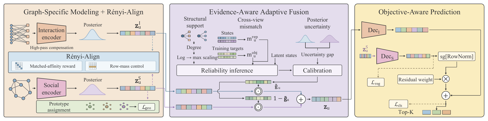

<h1 align="center">APHD</h1>

<p align="center">
  <strong>Let Each View Shine:</strong><br>
  Role-Preserving Probability-Space Collaboration<br>
  for Heterogeneous Dual-Graph Social Recommendation
</p>

<p align="center">
  
</p>

---


**APHD (Asymmetric Personalized Heterogeneous Dual-Graph Recommendation)** is a social recommendation framework that models interaction and social graphs according to their distinct information roles. It connects individual preferences with neighborhood preference patterns through probability-space collaboration, then adaptively combines the two views according to their reliability to produce personalized recommendations.

## Install

Install [PyTorch](https://pytorch.org/get-started/locally/) for your system and CUDA version, then install the remaining dependencies:

```bash
python -m pip install numpy scipy
```

## Datasets

Download Douban-Book, Douban-Movie, and Yelp [Here](https://api.github.com/repositories/783168078/zipball/2cdb4e0dfcdd129e5c42ac8eb2ec42322b3ae4ff). Extract the archive and run the following command from the APHD repository root before training. Replace `../datasets/Data` with the path to the extracted `Data` directory.

```bash
python prepare_data.py --source ../datasets/Data
```

The script creates `./Data/` with APHD's fixed 7:1:2 splits. It sets aside part of each upstream training set for validation and preserves the original test sets and social graphs.
